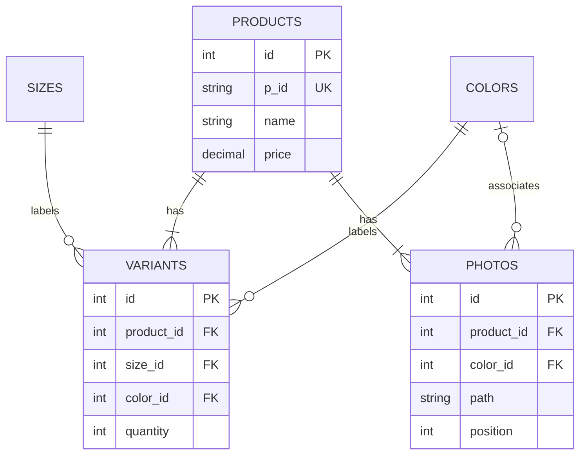

# Arrchit Shop Studio

A clothing inventory admin built with React + TypeScript + Vite and a PHP 8.4 JSON API. No public registration: administrators are created through a CLI command.

## What it does

- Sign in/out with hashed passwords, regenerated sessions, CSRF protection, and HTTP-only SameSite cookies.
- Login throttles: five attempts per account and 30 attempts per IP in a fixed 15-minute window; blocked requests return HTTP 429 and `Retry-After`. Successful login clears the account bucket.
- Create, edit, search, and delete products. Filter low stock (1–9 units) or out-of-stock products.
- One unique `p_id` identifies a product, regardless of color or size. Edit the existing product to add a new color; duplicate product IDs are rejected. Names may repeat across distinct IDs.
- Product-level name, description, and price; per-color/per-size stock quantities. A size/color pair occurs only once per product.
- Default sizes S, M, L, 28, 29, 30. Add arbitrary sizes and named color swatches from settings or the product editor.
- Up to 12 JPEG, PNG, or WebP photos, each up to 5 MB. The first photo is the cover; move images up/down to change it. Photos can belong to a particular color or all colors.

Prices are displayed in USD and stored as decimal values. New installs start with an empty product collection, not pretend inventory.

## Development

Requirements: Node 22.12+ (Node 24 recommended), npm, PHP 8.4 with PDO, `pdo_sqlite` (or `pdo_mysql`), mbstring, session, and image metadata support (`getimagesize`). No Composer install is needed by the new API.

```bash
npm ci
php backend/bin/setup.php
# Choose your own first administrator credentials:
export ADMIN_EMAIL=owner@example.com
export ADMIN_NAME='Store owner'
read -rsp 'Admin password (12–72 bytes): ' ADMIN_PASSWORD; echo
export ADMIN_PASSWORD
php backend/bin/setup.php --create-admin
unset ADMIN_PASSWORD
```

The setup command is repeatable: it creates missing tables/options and never replaces an existing administrator password. It does not migrate a previous application's tables; use a new database for this version.

Start the API and frontend in separate terminals:

```bash
php -d upload_max_filesize=5M -d post_max_size=65M -S 127.0.0.1:8000 -t backend/public backend/public/index.php
npm run dev -- --host 0.0.0.0 --port 5173 --strictPort
```

Vite proxies `/api` and `/uploads` to PHP. API calls use the same origin, so no hardcoded external domain or CORS setup is required. Without a database DSN, SQLite is created at `backend/var/shop.sqlite`. Local data, sessions, and uploads are ignored by Git. The cloud setup provides PHP at `/workspace/.onboarding/bin/php`; substitute that path or add `/workspace/.onboarding/bin` to PATH. The initial cloud development administrator's generated login is stored privately at `/workspace/.onboarding/admin-login.txt`, outside the repository.

## Database structure / MySQL

The complete importable schema is [backend/database/schema.mysql.sql](backend/database/schema.mysql.sql). SQLite's equivalent is [backend/database/schema.sqlite.sql](backend/database/schema.sqlite.sql).

| Table          | Purpose                                                                   |
| -------------- | ------------------------------------------------------------------------- |
| `admins`       | Administrator identity and password hash                                  |
| `login_limits` | Hashed account/IP rate-limit buckets and expiry                           |
| `products`     | Unique `p_id`, name, description, decimal price                           |
| `sizes`        | Extensible size labels: S, M, L, 28, etc.                                 |
| `colors`       | Extensible color names and hex swatches                                   |
| `variants`     | Product + color + size + quantity; unique combination                     |
| `photos`       | Product image path, optional color, ordered position; position 0 is cover |

`products` has many `variants` and `photos`. Each variant references one size and one color. Deleting a product cascades its variant and photo rows; the API also deletes its files. Sizes/colors cannot be removed while referenced.

For MySQL 8+ or MariaDB 10.6+, create an empty database using `utf8mb4`, grant a dedicated database user access, then set these process variables before both setup and API startup:

```bash
export DB_DSN='mysql:host=127.0.0.1;port=3306;dbname=arrchit;charset=utf8mb4'
export DB_USER=arrchit
# Set DB_PASSWORD securely in your shell or environment settings.
php backend/bin/setup.php
# Run --create-admin with ADMIN_EMAIL / ADMIN_PASSWORD as above.
```

The schema file can also be imported directly, but run `setup.php` afterward to seed default sizes and colors. SQLite and MySQL use the same API behavior. Do not point this schema at an existing production database without reviewing migration requirements.

## API

All responses are JSON. Fetch `GET /api/session` first to receive `csrf`; send it as `X-CSRF-Token` for every mutation, including login. Send session cookies with requests. Login returns a new CSRF token. Product/options routes require authentication.

| Method | Endpoint             | Body / result                             |
| ------ | -------------------- | ----------------------------------------- |
| GET    | `/api/session`       | Current administrator or null, CSRF token |
| POST   | `/api/login`         | JSON `email`, `password`                  |
| POST   | `/api/logout`        | Ends the session                          |
| GET    | `/api/options`       | Sizes and colors                          |
| POST   | `/api/sizes`         | JSON `label`                              |
| POST   | `/api/colors`        | JSON `name`, `hex`                        |
| GET    | `/api/products`      | Products with variants and ordered photos |
| POST   | `/api/products`      | Multipart product create/update           |
| DELETE | `/api/products/{id}` | Deletes product and uploaded files        |

For saving a product, send a `product` multipart field containing JSON: optional internal `id` for updates, `p_id`, `name`, `description`, `price` (decimal string), `variants: [{size_id,color_id,quantity}]`, and ordered `photos: [{key,color_id}]`. New files are sent as `photos[]`, referenced by `new:0`, `new:1`, etc. Existing photos use `old:{photo_id}` and must belong to that product. Omitting an existing photo removes it. `color_id: null` means all colors. At least one photo and variant are required.

## Checks

```bash
npm run build
npm run lint
PHP_BIN=php python3 backend/tests/integration.py
```

The integration suite starts its own PHP server against a temporary SQLite database and random test credentials. It covers login/logout, CSRF, throttling/expiry, custom options, duplicate IDs/variants, stock, valid/invalid uploads, cover reordering, and cascading deletion. It never uses the development administrator or inventory.

To exercise the same tests against a **disposable, empty** MySQL/MariaDB database, set `TEST_MYSQL_DSN`, `TEST_MYSQL_USER`, and `TEST_MYSQL_PASSWORD` before running the suite. It creates test tables and an administrator; never use a real inventory database. Both SQLite and MariaDB 11.4 were validated during implementation.



## Production

Build with `npm run build`. Serve `dist` through your HTTPS web server with SPA fallback, route `/api/*` to `backend/public/index.php`, and serve `/uploads/*` as images from `backend/public/uploads`. Only `backend/public` belongs in the backend web root. Disable script execution in the upload directory, and never expose database files, sessions, configuration, or CLI scripts. Set `APP_ENV=production` so cookies require HTTPS. Configure PHP and web-server request limits for 65 MB total and 5 MB per image. PHP's built-in development server is not a production server.

Keep the database and uploads on persistent storage and back them up together. Provision production credentials through environment settings. This is inventory administration; checkout, order processing, password recovery emails, and staff role management are outside this version.
